# Week 2 – Exploratory Data Analysis and Visualization of Logistics Data

## Project Overview

This project focuses on Exploratory Data Analysis (EDA) and visualization of NYC Yellow Taxi Trip Records for January 2024.

Using Python, Pandas, Matplotlib, and Seaborn, the project explores transportation patterns, trip characteristics, demand trends, payment methods, fare relationships, and frequently used pickup and drop-off locations.

The objective is to extract meaningful insights from transportation data and identify patterns that can support better logistics and fleet planning decisions.

## Objectives

- Analyze trip distance and trip duration distributions.
- Identify hourly and daily transportation demand patterns.
- Compare weekday and weekend travel activity.
- Examine payment methods and fare distributions.
- Analyze correlations between numerical variables.
- Identify the most frequently used pickup and drop-off locations.
- Communicate findings through meaningful visualizations.

## Dataset Information

- **Dataset:** NYC Yellow Taxi Trip Records
- **Period:** January 2024
- **Initial cleaned records:** 2,963,707
- **Columns:** 23
- **Records used for January analysis:** 2,963,689
- **Records outside January excluded from analysis:** 18

The cleaned dataset contains trip timestamps, distance, duration, fare amounts, payment types, passenger counts, and location identifiers.

The original cleaned CSV is not included in this repository because of its size.

## Technologies Used

- Python 3.12.4
- Pandas
- Matplotlib
- Seaborn
- Visual Studio Code
- Git and GitHub

## Data Analysis and Methodology

1. Loaded the cleaned taxi dataset using Pandas.
2. Inspected dataset structure, data types, missing values, and duplicate records.
3. Converted timestamp and numerical columns into appropriate data types.
4. Filtered records to include January 2024 only.
5. Performed descriptive statistical analysis.
6. Analyzed hourly, daily, and weekday/weekend demand.
7. Examined fare relationships and payment categories.
8. Calculated correlations between selected numerical variables.
9. Identified the top pickup and drop-off location IDs.
10. Generated 11 visualizations using Matplotlib and Seaborn.

## Key Findings

### 1. Overall Trip Statistics

| Metric | Result |
|---|---:|
| Average trip distance | 3.23 miles |
| Median trip distance | 1.68 miles |
| Average trip duration | 15.60 minutes |
| Median trip duration | 11.63 minutes |
| Average total amount | $26.79 |

### 2. Hourly Demand Analysis

- Peak demand occurred at **6 PM**, with 212,739 trips.
- Lowest demand occurred at **4 AM**, with 16,730 trips.
- Demand generally increased throughout the day and reached its highest level in the evening.

### 3. Daily Demand Analysis

- Busiest date: January 27, 2024 – 110,473 trips.
- Lowest-demand date: January 7, 2024 – 67,528 trips.

### 4. Weekday vs Weekend Analysis

| Metric | Weekday | Weekend |
|---|---:|---:|
| Total trips | 2,203,481 | 760,208 |
| Average distance | 3.25 miles | 3.17 miles |
| Average duration | 15.98 minutes | 14.49 minutes |
| Average fare | $27.21 | $25.58 |

Weekdays recorded higher total trip volume and slightly higher average trip distance, duration, and fare.

### 5. Payment Method Analysis

- Payment type 1 recorded the highest number of trips: 2,318,919.
- Payment type 2 recorded 438,542 trips.
- Payment type 1 had an average total amount of $28.25 and average tip of $4.17.

Payment categories are retained as numeric codes; their labels should be interpreted using the official TLC data dictionary.

### 6. Correlation Analysis

| Variable Relationship | Correlation |
|---|---:|
| Trip distance vs Fare amount | 0.842 |
| Trip distance vs Total amount | 0.847 |
| Trip distance vs Tip amount | 0.568 |
| Trip distance vs Trip duration | 0.276 |

Trip distance showed a strong positive relationship with fare amount and total amount.

Correlation indicates association, not causation.

### 7. Location Analysis

Frequently occurring pickup location IDs included:

- 132 – 145,177 trips
- 161 – 143,444 trips
- 237 – 142,678 trips
- 236 – 136,432 trips

Frequently occurring drop-off location IDs included:

- 236 – 142,037 trips
- 237 – 130,241 trips
- 161 – 111,940 trips

These identifiers require the TLC taxi-zone lookup table for geographic interpretation.

## Visualizations

The project includes 11 visualizations.

### 1. Trip Distance Distribution
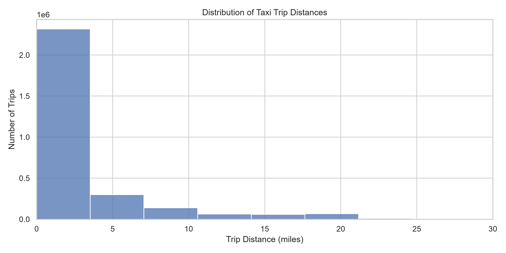

### 2. Trip Duration Distribution
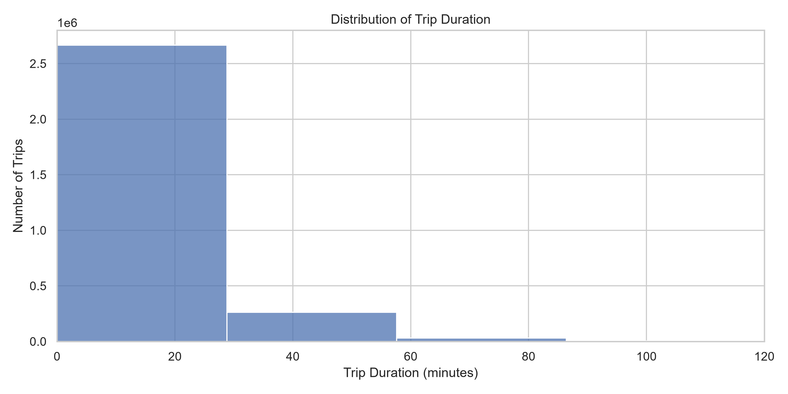

### 3. Hourly Demand Analysis
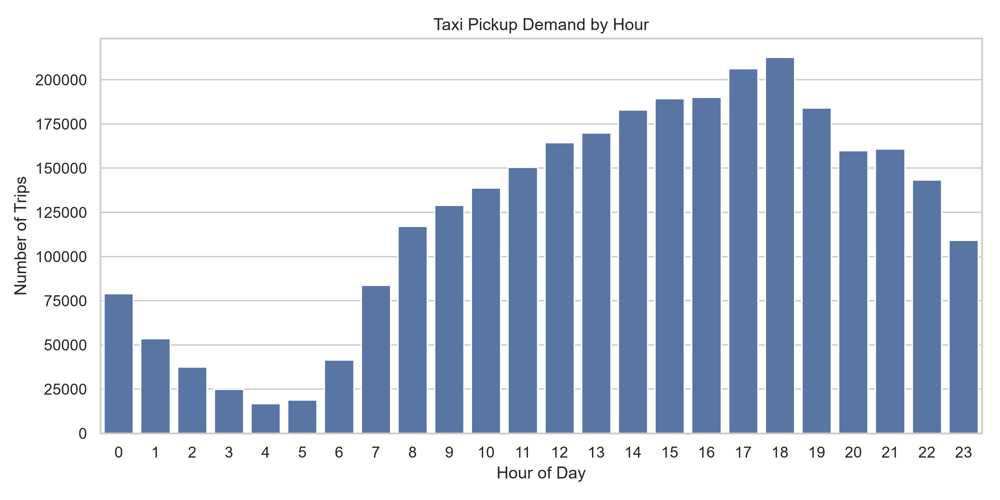

### 4. Daily Demand Analysis
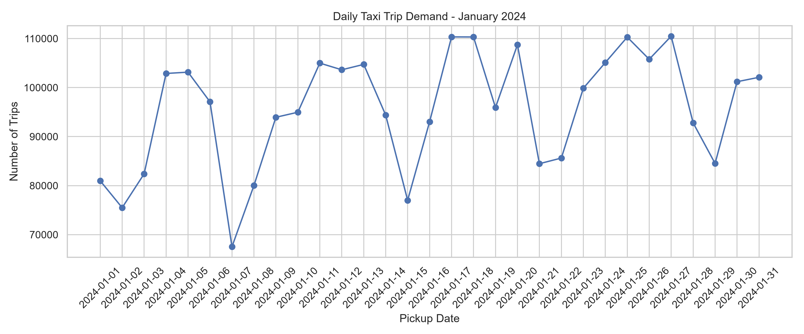

### 5. Distance vs Fare Relationship
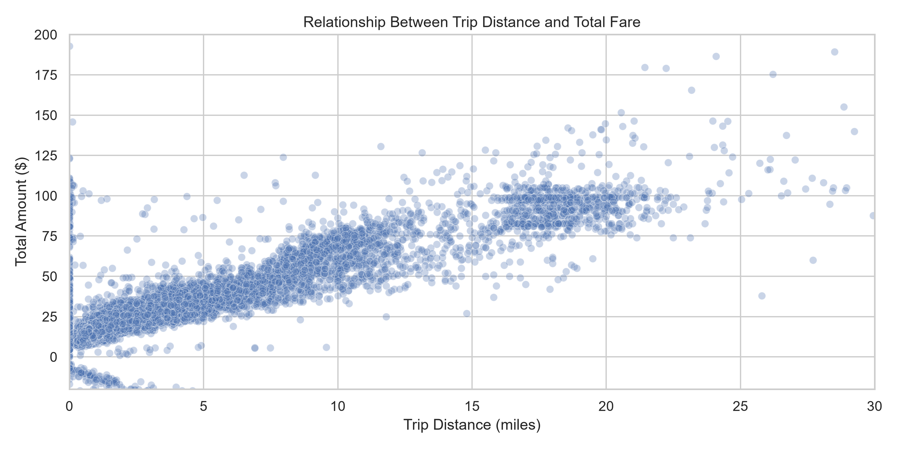

### 6. Fare Distribution by Payment Type
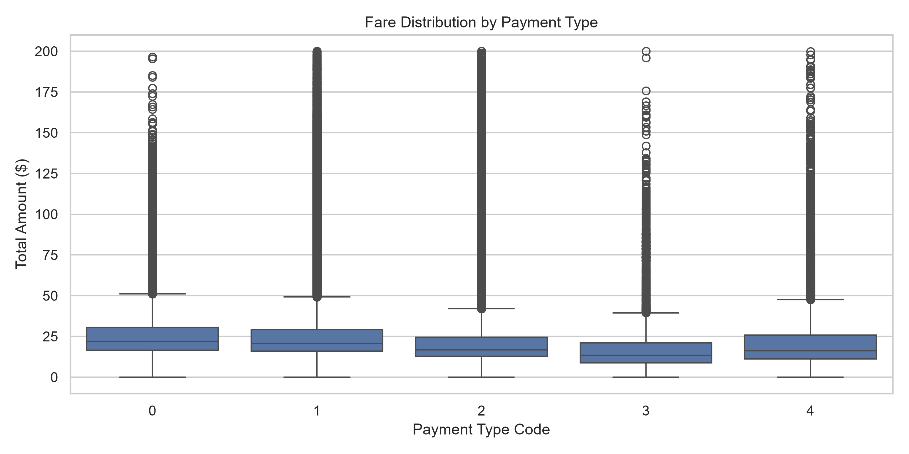

### 7. Weekday vs Weekend Analysis
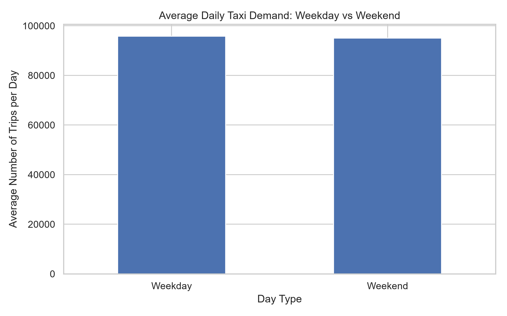

### 8. Payment Method Analysis
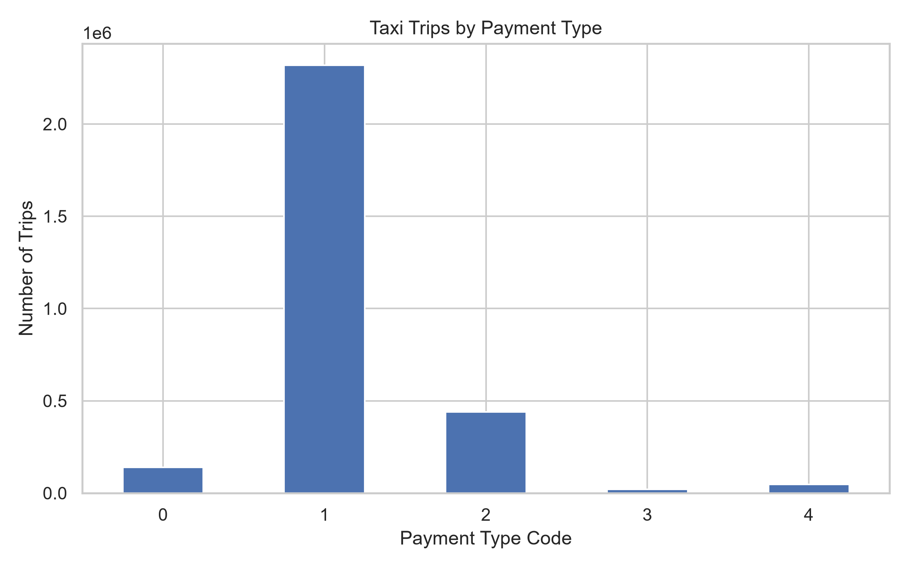

### 9. Correlation Heatmap
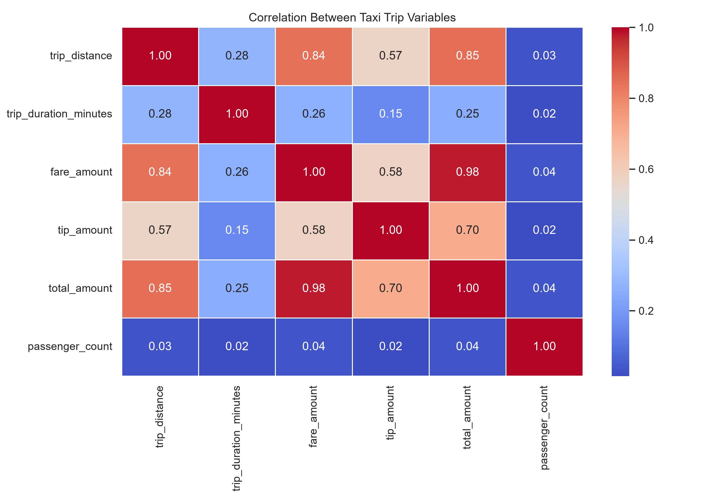

### 10. Top 10 Pickup Locations
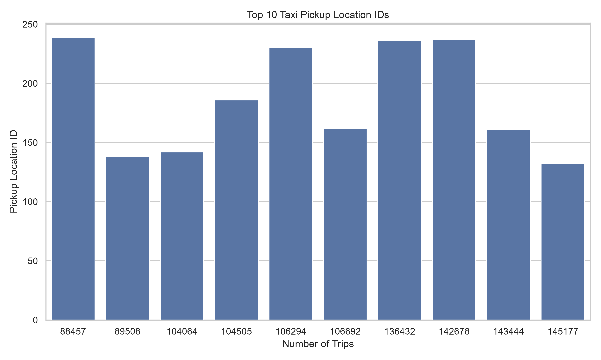

### 11. Top 10 Drop-off Locations
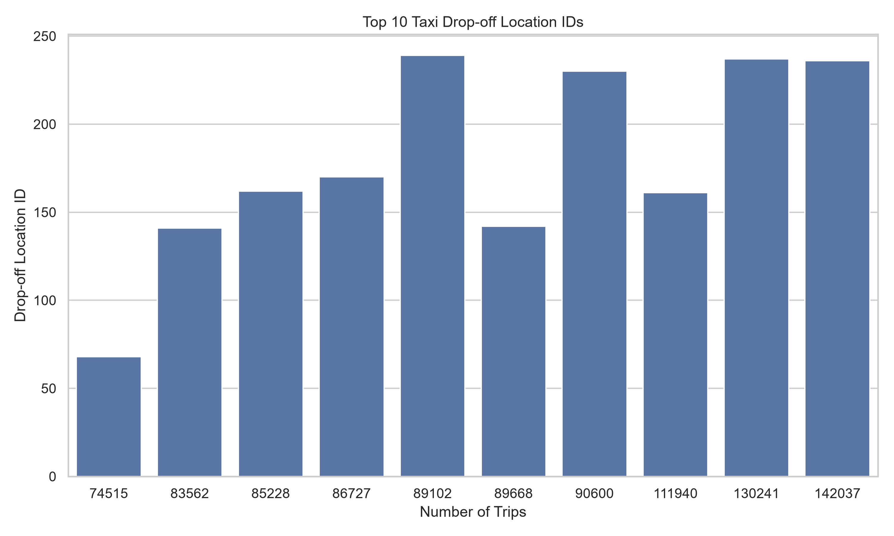

## Logistics Recommendations

- Consider increasing driver availability during the evening demand peak.
- Plan fleet allocation according to weekday and weekend demand differences.
- Investigate high-frequency pickup and drop-off zones.
- Monitor trip distance, duration, and fare relationships.
- Validate payment categories and missing data before further analysis.
- Extend the analysis to multiple months to identify seasonal patterns.

## Project Structure

```text
week2/
│
├── README.md
├── analysis.py
├── Week2_Logistics_EDA_Report.docx
│
└── visualizations/
    ├── 01_trip_distance.png
    ├── 02_trip_duration.png
    ├── 03_hourly_demand.png
    ├── 04_daily_demand.png
    ├── 05_distance_vs_fare.png
    ├── 06_fare_by_payment.png
    ├── 07_weekday_vs_weekend.png
    ├── 08_payment_methods.png
    ├── 09_correlation_heatmap.png
    ├── 10_top_pickup_locations.png
    └── 11_top_dropoff_locations.png
```

## How to Run the Project

1. Clone the repository.
2. Install the required Python libraries:

```bash
pip install pandas matplotlib seaborn
```

3. Ensure the cleaned dataset is available at:

```text
data/processed/yellow_tripdata_2024-01_clean.csv
```

4. Run the analysis script from the repository root:

```bash
python week2/analysis.py
```

The script generates the visualizations inside `week2/visualizations/`.

## Project Report

The complete Word report is available here:

`Week2_Logistics_EDA_Report.docx`

## Conclusion

This project demonstrates the use of Python-based exploratory data analysis and visualization to understand transportation data. The analysis identified important demand patterns, trip characteristics, fare relationships, payment distributions, and frequently used location identifiers.

The findings provide a foundation for further transportation analysis and data-driven logistics planning.

## References

- [NYC Taxi and Limousine Commission – Trip Record Data](https://www.nyc.gov/site/tlc/about/tlc-trip-record-data.page)
- [Pandas Documentation](https://pandas.pydata.org/docs/)
- [Matplotlib Documentation](https://matplotlib.org/stable/)
- [Seaborn Documentation](https://seaborn.pydata.org/)

---

**Project:** Week 2 – Exploratory Data Analysis and Visualization of Logistics Data  
**Tools:** Python | Pandas | Matplotlib | Seaborn
