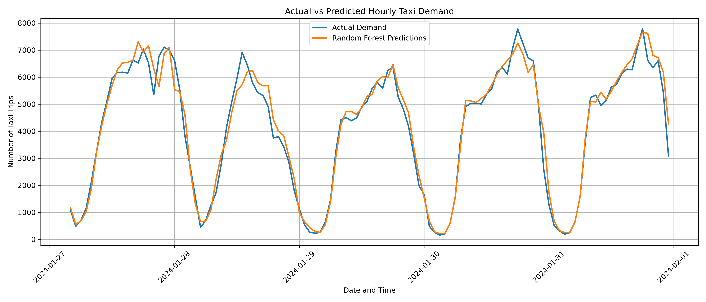
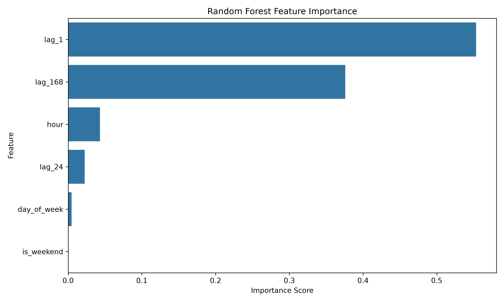

# Week 3: Logistics Demand Forecasting Using Machine Learning

## Project Overview

This project focuses on predicting hourly taxi demand using historical logistics data and machine learning techniques.

The NYC Yellow Taxi Trip Records for January 2024 were used to create an hourly demand dataset. Three regression models were developed and evaluated to identify the most effective model for forecasting taxi demand.

## Objectives

- Convert historical taxi trip records into hourly demand data.
- Perform feature engineering using time-based and historical demand features.
- Train and evaluate multiple machine learning models.
- Compare model performance using MAE, RMSE, and R² Score.
- Visualize actual versus predicted demand.
- Identify the most influential forecasting features.

## Dataset Information

- **Dataset:** NYC Yellow Taxi Trip Records
- **Period:** January 2024
- **Source:** NYC Taxi and Limousine Commission (TLC)
- **Target variable:** Hourly taxi demand
- **Hourly dataset size:** 744 records
- **Final forecasting dataset:** 576 records

The final dataset contains the following features:

| Feature | Description |
|---|---|
| hour | Hour of the day |
| day_of_week | Day of the week |
| is_weekend | Weekend indicator |
| lag_1 | Demand during the previous hour |
| lag_24 | Demand at the same hour on the previous day |
| lag_168 | Demand at the same hour in the previous week |

## Methodology

### 1. Data Preparation

- Loaded the cleaned January 2024 taxi dataset.
- Converted pickup timestamps into hourly demand counts.
- Created time-based forecasting features.
- Generated lag features using historical demand.
- Removed rows without sufficient historical lag information.

### 2. Train-Test Split

A chronological split was used to preserve the time-series order.

| Dataset | Records |
|---|---:|
| Training | 460 |
| Testing | 116 |
| Total | 576 |

- Training period: January 8, 2024, 00:00 to January 27, 2024, 03:00
- Testing period: January 27, 2024, 04:00 to January 31, 2024, 23:00

### 3. Machine Learning Models

Three regression algorithms were implemented:

1. Linear Regression
2. Decision Tree Regressor
3. Random Forest Regressor

### 4. Model Evaluation

The models were evaluated using:

- **MAE (Mean Absolute Error):** Measures average absolute prediction error.
- **RMSE (Root Mean Squared Error):** Measures prediction error while penalizing larger errors.
- **R² Score:** Measures how well the model explains variation in demand.

## Model Performance Comparison

| Model | MAE | RMSE | R² Score |
|---|---:|---:|---:|
| Linear Regression | 423.72 | 563.97 | 0.9406 |
| Decision Tree | 377.88 | 538.14 | 0.9459 |
| Random Forest | 279.07 | 400.58 | 0.9700 |

### Best Performing Model: Random Forest

The Random Forest Regressor achieved the best performance:

- MAE: 279.07
- RMSE: 400.58
- R² Score: 0.9700

The model achieved an R² score of approximately 97% on the test dataset.

## Feature Importance Analysis

The Random Forest model identified the following feature importance scores:

| Feature | Importance |
|---|---:|
| lag_1 | 0.553287 |
| lag_168 | 0.375777 |
| hour | 0.043199 |
| lag_24 | 0.022419 |
| day_of_week | 0.004707 |
| is_weekend | 0.000609 |

The previous-hour demand (`lag_1`) was the most influential feature, followed by previous-week demand (`lag_168`).

This indicates that recent historical demand and weekly demand patterns played an important role in the model's predictions.

## Visualizations

### Actual vs Predicted Hourly Taxi Demand



### Random Forest Feature Importance



## Key Findings

- Hourly taxi demand showed clear variations throughout the day.
- Historical demand features were highly useful for forecasting.
- Random Forest outperformed Linear Regression and Decision Tree.
- The previous-hour and previous-week demand features were the two most important predictors.
- The actual-versus-predicted graph shows that the Random Forest model follows the general demand pattern closely.

## Project Structure

```text
week3/
│
├── forecasting.py
│
├── models/
│   └── random_forest_model.pkl
│
├── reports/
│   ├── Week3_Logistics_Demand_Forecasting_Report.docx
│   ├── feature_importance.csv
│   ├── model_performance_comparison.csv
│   └── test_predictions.csv
│
├── visualizations/
│   ├── feature_importance.png
│   └── random_forest_actual_vs_predicted.png
│
└── README.md
```

## Technologies Used

- Python 3.12
- Pandas
- NumPy
- Matplotlib
- Seaborn
- Scikit-learn
- Joblib

## How to Run the Project

Run the following command from the main project directory:

```bash
python week3/forecasting.py
```

Install the required libraries using:

```bash
pip install -r requirements.txt
```

## Conclusion

This project demonstrates how machine learning can be applied to logistics demand forecasting using historical taxi trip records.

Among the three evaluated models, the Random Forest Regressor achieved the best test performance, with an MAE of 279.07, RMSE of 400.58, and R² score of 0.9700.

The results highlight the importance of historical demand patterns in forecasting hourly taxi demand.

## Limitations

- The analysis uses only January 2024 data.
- The forecasting dataset contains a limited number of hourly observations after lag-feature creation.
- Model performance on other months and future periods has not yet been established.
- Additional data, such as weather, holidays, and special events, could improve forecasting.

## Author

Darshan R

## Project Repository

[Logistics Data Collection and Cleaning – GitHub](https://github.com/Darshan777777/Logistics-Data-Collection-and-Cleaning)